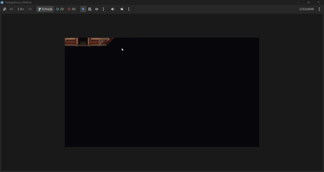
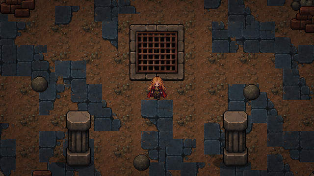
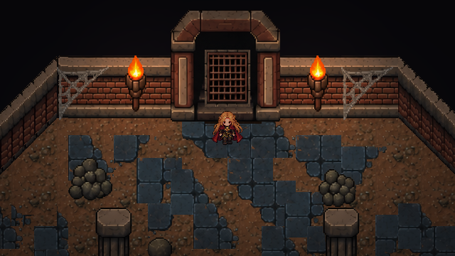
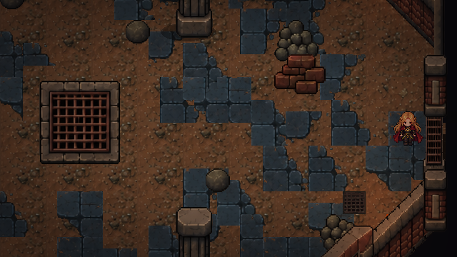
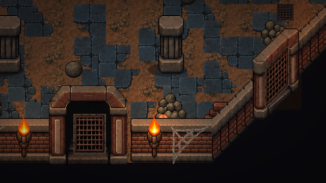

# The Eight Doors — cena principal corrigida

Entrega verificada na Godot 4.7.1 em 27/10/2026. Execute **F5** para abrir `res://scenes/world/environments/sala_central_jogavel.tscn`. WASD, incluindo combinações diagonais. A execução final foi deixada aberta, com Aelin em `(560, 640)`.

## 1. Cena e diagnóstico

A cena de desenvolvimento já existente foi corrigida; a referência não foi regravada. Antes da tarefa, `application/run/main_scene` não estava definido. A cena aberta no editor era `sala_central_jogavel.tscn`.

A câmera havia sido movida para dentro de Aelin, em `(0, -160)`, mas ainda executava `camera_sala_central.gd`: esse script calculava a posição do centro da sala em coordenadas locais e diminuía o zoom para mostrar a sala inteira. O deslocamento de Aelin era somado a esse enquadramento. Isso explica a sala pequena, deslocada e desaparecendo na gravação. Os batentes laterais também tinham posições alteradas e um deles estava invisível.

A gravação de 41,77 segundos foi decodificada para inspeção. Os cinco arquivos `antes_video_*.png` mostram o problema original.

## 2. Arquivos alterados e adicionados

Arquivos existentes alterados:

- `project.godot`: cena principal, viewport, fullscreen e renderização.
- `scenes/world/environments/sala_central_jogavel.tscn`: câmera, profundidade, passagens, grades e vinheta.
- `tools/dungeon_central/montar_jogavel.gd`: encaminha ao gerador atual; o comando antigo não reintroduz os corredores e a câmera antigos.
- `tests/test_dungeon_jogavel.gd`: encaminha à auditoria atual, cuja especificação exige portas fechadas.

Novos arquivos de implementação:

- `scripts/camera/camera_exploracao.gd`.
- `scripts/world/passagem_preparada.gd`.
- `assets/shaders/vinheta.gdshader`.
- `tools/dungeon_central/corrigir_cena_principal.gd`.
- `tools/dungeon_central/capturar_principal.gd`.
- `tests/test_cena_principal.gd`.
- `tests/test_resolucoes.gd`.
- `tests/runtime_cena_principal.gd` — somente testes via MCP.

Os arquivos `.uid` correspondentes são metadados gerados pela Godot. Relatórios, planos MCP, capturas e logs desta entrega ficam nesta pasta. A lista e os hashes estão em `preservacao_e_arquivos.json`.

## 3. Backups e preservação

Antes de alterar arquivos existentes, foram criadas cópias em `backups/cena_principal_2026-10-27/`, com `.gdignore`. Os caminhos originais estão codificados nos nomes com `__`.

Há backups do projeto, das duas cenas de dungeon, das cenas de Aelin e Dorian, do controlador compartilhado, do script antigo de câmera, do script lateral antigo, do gerador antigo e do teste anterior.

`sala_central_referencia.tscn`, `aelin.tscn`, `dorian.tscn`, `personagem_top_down.gd`, `camera_sala_central.gd` e `passagem_lateral.gd` permaneceram idênticos aos backups, verificados por SHA-256. Os PNGs originais não foram editados. Nenhuma outra sala foi carregada na cena jogável.

## 4. Resolução e fullscreen

- Resolução interna: **640×360**, 16:9.
- Resolução física verificada: **1920×1080**, fullscreen `DisplayServer.WINDOW_MODE_FULLSCREEN = 3`.
- Stretch: `viewport`; aspect: `keep` (valor padrão, confirmado pelo MCP).
- Escala em Full HD: 3×; em 1280×720: 2×.
- Filtro nearest e snap de transformações 2D habilitados. Escala de Aelin preservada.

A janela embutida do editor usada na primeira inspeção foi substituída pela execução da cena principal com as configurações recarregadas. A captura nativa mostrou o jogo ocupando a tela, sem a barra de ferramentas da janela embutida.

## 5. Zoom

**Zoom da Camera2D: `(1, 1)`**. O campo de visão cobre 640×360 unidades: aproximadamente 40×22,5 tiles de 16 pixels. A sala ocupa cerca de 1056×976 unidades considerando arquitetura, por isso o enquadramento percorre a sala em vez de reduzi-la inteira à tela.

## 6. Acompanhamento e limites

A única câmera existente foi reutilizada como filha de Aelin e recebeu um script próprio da cena jogável. Posição local `(0, -24)`, centralizando visualmente o corpo; offset zero, sem drag, sem suavização, sem arredondamento manual independente do personagem. Atualização no ciclo de física.

Limites em coordenadas do mundo: **esquerda 32, topo 16, direita 1088, fundo 992**. Nas bordas, Aelin sai do centro enquanto a câmera para no limite. O teste ao vivo mediu erro relativo máximo de acompanhamento **0,0** nas oito direções, em posições afastadas dos limites.

O exterior do octógono continua sendo a silhueta escura do fundo existente. Pequenos cantos escuros junto à arquitetura são intencionais; não há corredores ou outras salas exibidos além das entradas, nem deslocamento da câmera para o vazio.

## 7. Vinheta

`Atmosfera` é um `CanvasLayer` de camada 10. Seu `ColorRect/Vinheta` ocupa a tela, ignora mouse e usa shader `unshaded` com transição `smoothstep`.

Parâmetros editáveis no ShaderMaterial: **intensidade 0,40**, **raio 0,32**, **suavidade 0,58**. O centro não recebe o escurecimento máximo; as bordas recebem a transição suave. O efeito usa UV da tela e não oscila com a câmera. Não implementa fog of war nem bloqueia o input.

## 8. Profundidade da parede inferior

Foram extraídos somente os tiles arquitetônicos na metade inferior, a partir de `y=704`, para camadas separadas:

- `ParedesFrente`: 246 células.
- `MoldurasFrente`: 63 células.
- `PortasFrente`: 146 células.

Essas camadas usam z-index 4. As paredes superiores continuam em sua ordem original, atrás do personagem. Aelin e os pilares mantêm a ordenação pelos pés. As tochas e teias inferiores receberam ordem adequada para permanecerem visíveis sobre suas paredes.

`mcp_profundidade.png` mostra a cabeça parcialmente visível acima do muro e o restante oculto. Mais perto da base externa, a ocultação completa pela parede é intencional. `comparacao_sem_frente.png` é uma captura diagnóstica com as camadas frontais temporariamente escondidas, apenas no processo de captura; o jogo entregue mantém todas habilitadas.

## 9. Colisões

- Geometria explícita das 16 partes de parede preservada e transformações normalizadas.
- Camada do cenário 1, máscara 2; Aelin continua na camada 2, máscara 1.
- Cápsula de Aelin preservada: raio 8, altura 18, centro local `(0, -6)`.
- Quatro pilares sólidos; entulho decorativo, respiros e grade de piso continuam atravessáveis.
- TileMapLayers inspecionados: todos os TileSets tinham zero camadas físicas. A colisão automática das camadas visuais foi explicitamente desabilitada para manter uma única fonte de geometria física.
- Oito bloqueios de porta de 112×28 unidades, orientados conforme cada parede, fecham também as quatro passagens diagonais antes desprotegidas.
- Colisões externas dos corredores antigos foram removidas junto com esses corredores. Não há saída livre para o fundo escuro.

O controlador continua usando `Input.get_vector()` e `move_and_slide()`, modo flutuante, velocidade de 144 unidades/s. Não foram introduzidos pulo ou gravidade.

## 10. Portas e acabamento

As oito molduras existentes foram conservadas. As laterais receberam batentes alinhados e grade estreita no plano da parede. Foram removidas **60 células de piso/túnel externo**, além das soleiras e limites prolongados do modelo anterior.

As grades reutilizam a região de ferro do atlas existente `assets/environments/generated/dungeon_central/atlas_sala_central.png`, sem editar a imagem. Nas diagonais, o eixo horizontal acompanha a inclinação da soleira; as barras permanecem verticais. Grades visíveis comunicam os bloqueios físicos atuais.

## 11. Preparação das transições

`Passagens` contém oito `Area2D`, com direção, `cena_destino` vazia e `ponto_entrada` vazio. Cada uma tem:

- `ZonaDeteccaoInativa`, com `monitoring=false` e `monitorable=false`.
- `PlanoDaPorta/BloqueioFechado`, sólido.
- `PontoEntradaFuturo`, 64 unidades para dentro da sala.
- Grade visual fechada.

Não há conexão de `body_entered`, troca de cenas, teletransporte ou destino inventado. O script lateral antigo permanece preservado, mas não é usado pela cena corrigida.

## 12. Resultados dos testes

`testes_funcionais.json`: **nenhuma falha**.

- 192 varreduras da cápsula de Aelin ao longo de todo o perímetro, incluindo junções e portas.
- 16 aproximações dos quatro pilares, em quatro direções.
- Oito combinações de teclas WASD, normalização de velocidade e parada ao soltar.
- Sete posições de câmera dentro dos limites, câmera única e detectores de portas inativos.

`testes_mcp_runtime.json`: **nenhuma falha**, executado no jogo aberto pelo Godot AI MCP.

- Fullscreen físico 1920×1080, viewport 640×360, aspect `keep`.
- Oito movimentos reais via eventos de teclado: velocidade 144 e acompanhamento relativo sem desvio.
- Oito portas efetivamente bloqueadas.
- Seis posições de câmera e capturas salvas pelo jogo.
- `logs_final_mcp.json`: uma mensagem informativa do helper, sem erros ou avisos de runtime.

`testes_resolucoes.json`: tamanhos 1280×720, 1600×900, 1920×1080, 1366×768 e 1280×1024, todos mantendo viewport lógico 640×360. Os transforms registrados são os internos ao viewport; a escala física resulta do stretch da janela. Nenhuma falha nesses testes.

Inspeção visual feita em duas rodadas, incluindo centro, norte, sul, leste, oeste, duas diagonais e sobreposição da parede inferior. O topo da porta norte e a ordem das tochas foram refinados após a primeira rodada.

O MCP inicialmente estava desconectado. O backend instalado foi iniciado localmente e adotado pelo plugin; a conexão final e o helper do jogo ficaram ativos. Um erro de inferência de tipo no script de teste foi corrigido e validado antes de executar esse teste no jogo. Nenhum erro permaneceu na execução final.

## 13. Evidências antes e depois

Antes, extraído da gravação:

Depois, captura do jogo via MCP:

## 14. Limitações e próximos passos

As transições entre salas permanecem deliberadamente não implementadas. Para adicioná-las, será necessário definir destinos reais, habilitar os detectores e coordenar a abertura das grades com a transição.

Em telas que não sejam 16:9, `keep` preserva proporção com barras proporcionais: preencher uma tela 5:4 mantendo todo o conteúdo 16:9 exigiria deformar ou cortar a imagem. Em resoluções com escala fracionária, nearest mantém os contornos sem filtro borrado, mas alguns pixels físicos terão larguras diferentes. As resoluções 720p e 1080p têm escala inteira.

Os testes cobrem a sala atual e o monitor disponível. Não foram testados outros monitores físicos nem exportação do executável. O teste de resoluções usou janelas redimensionadas na Godot. Não foi alterado o funcionamento de Dorian ou de outras salas.

### Referências técnicas

Configuração baseada nas APIs da versão instalada e nas documentações oficiais de [Camera2D](https://docs.godotengine.org/en/stable/classes/class_camera2d.html) e [múltiplas resoluções](https://docs.godotengine.org/en/stable/tutorials/rendering/multiple_resolutions.html).
