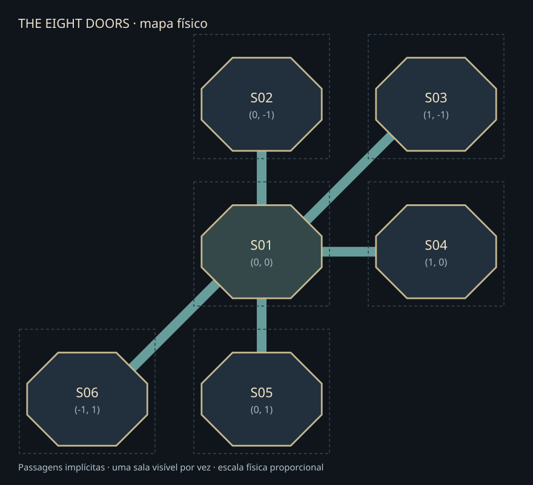

# The Eight Doors — primeira expansão octogonal

Protótipo de seis salas, criado a partir da dungeon atual de 29/10/2026 e validado na Godot **4.7.1**. A cena principal é `res://scenes/world/labyrinth/labirinto.tscn`: use **F5**, com movimento **WASD**, incluindo diagonais. Aelin começa em S01. As transições são automáticas ao se aproximar das portas abertas.

## Arquivos e arquitetura

```text
scenes/labirinto/
  labirinto.tscn             Cena principal, atmosfera e identificação da sala
  labirinto.gd               Jogador persistente, carregamento, spawn e câmera
  sala_octogonal_base.tscn   Única base visual reutilizada pelas seis salas
  sala.gd                   Configuração das portas e limite físico de segurança
  porta.gd                  Direção, destino, detecção, grade, selo e ponto de entrada
  mapa.gd                   Coordenadas, conexões, geometria e validação
  atmosfera.tscn            Vinheta única, com shader e parâmetros existentes
tests/
  test_labirinto.gd          Testes físicos e funcionais com Aelin e Dorian
  runtime_labirinto.gd       Testes e capturas no jogo aberto pelo MCP
tools/labirinto/
  extrair_base.py            Extração inicial da cena atual; não é preciso regenerar
  mcp_probe.py              Cliente MCP usando a instalação Python 3.12 existente
  preparar_validacao_mcp.py Plano de chamadas curtas para o editor
  auditar_entrega.py         Hashes, referências, inventário e desenho do mapa
```

A base contém os TileMapLayers Piso, TransicoesPiso, Entulho, Tunel, Paredes, Molduras, Portas, SombrasElementos, Elementos e as três camadas de arquitetura frontal. Preserva colunas, tochas, iluminação, molduras, oito modelos de portas e as colisões atuais. Não contém jogador, câmera ou CanvasLayer de vinheta.

Somente uma instância da sala-base está na árvore por vez. Cada configuração tem ID, coordenada, conexões explícitas e indicação de spawn seguro. A posição global da sala corresponde à coordenada física. O mesmo CharacterBody2D é reparentado na troca para conservar a ordenação Y com os pilares, sem recriar personagem, AnimatedSprite2D ou câmera. A sala anterior é removida antes de instanciar a próxima.

## Inspeção e preservação

- Projeto confirmado: `project.godot`, Godot 4.7.1, viewport 640×360 e janela configurada para 1280×720.
- Dungeon original: `scenes/world/environments/sala_central_jogavel.tscn`, preservada byte a byte, inclusive alterações recentes em paredes, batentes e decoração.
- A cena `scenes/dungeon/sala_central_referencia.tscn` **já não existia** no início desta tarefa. Há cópias históricas nos backups anteriores, incluindo `backups/cena_principal_2026-10-27/scenes__dungeon__sala_central_referencia.tscn.bak`. Não foi recriada nem usada para sobrescrever o trabalho atual.
- Aelin era uma instância da cena de personagem, com Camera2D filha e `camera_exploracao.gd`. A expansão reutiliza esse mesmo script de câmera, sem o editar.
- Os oito Area2D existentes usavam `passagem_preparada.gd`, sem destinos e com detectores inativos. Apenas a nova base usa o controlador `porta.gd`.
- Cápsulas atuais preservadas: Aelin, raio 14 e altura 48, posição (0,-25); Dorian, raio 12 e altura 52, posição (1,-28). Os relatórios antigos descreviam cápsulas menores e não foram tratados como estado atual.
- SpriteFrames, sprites, cenas dos personagens, controlador `personagem_top_down.gd` e revisão gráfica permaneceram intactos. `preservacao.json` verifica **210 arquivos protegidos**, sem mudanças, além dos arquivos de origem copiados no backup.

## Mapa espacial

| ID | Coordenada lógica | Origem física da sala | Portas abertas |
|---|---|---|---|
| S01 | (0,0) | (0,0) | N→S02, NE→S03, L→S04, S→S05, SO→S06 |
| S02 | (0,-1) | (0,-1216) | S→S01 |
| S03 | (1,-1) | (1440,-1216) | SO→S01 |
| S04 | (1,0) | (1440,0) | O→S01 |
| S05 | (0,1) | (0,1216) | N→S01 |
| S06 | (-1,1) | (-1440,1216) | NE→S01 |

```text
             S02         S03
              │         ╱
              │        ╱
             S01 ───────── S04
            ╱ │
           ╱  │
        S06  S05
```



Não foi preciso alterar as coordenadas propostas. O passo físico é **(1440,1216)**, calculado para a geometria assimétrica da sala existente. Os portais N/S estão em (560,192)/(560,960); L/O em (1056,576)/(64,576); NE/SO em (928,320)/(192,832). Assim:

- Entre portais cardinais opostos, a passagem mede 448 px e permanece alinhada ao eixo da porta.
- Entre NE/SO opostos, o vetor da passagem é (704,-704), ou seu oposto: alinhamento exato de 45°, comprimento aproximado de 995,6 px.
- O envelope conservador de cada sala é 1120×1024. O validador verifica sobreposição de envelopes, direção e reciprocidade, interseção das passagens de 80 px de largura com salas alheias e cruzamento entre passagens.

As passagens externas são **implícitas na transição**, não corredores navegáveis/renderizados nesta etapa. A distância e o alinhamento têm geometria definida, mesmo com carregamento isolado. Não se pode ver uma sala vizinha antes de atravessar. Salas vizinhas geometricamente adjacentes não recebem conexões automáticas.

## Portas, retorno e segurança

`porta.gd` reutiliza cada Area2D, ZonaDeteccaoInativa, PlanoDaPorta/BloqueioFechado/Forma, GradeFechada e PontoEntradaFuturo. O nome histórico da zona foi mantido, mas a detecção está habilitada na nova base.

Cada porta possui direção, sala de origem, destino, direção oposta de entrada, estado aberto/selado, área física e marcador de chegada. Portas abertas escondem a grade e desativam o bloqueio. Portas seladas mantêm a grade e a colisão, com um selo linear azulado discreto e independente da iluminação. Nenhum sprite novo foi criado.

O gerenciador valida origem/destino e corpo, bloqueia pedidos concorrentes e adia a troca para fora do processamento de consultas físicas. A chegada usa o marcador da porta oposta, 64 px para dentro. O bloqueio de retorno exige **250 ms**, saída da área e afastamento de mais de **88 px** do portal, obrigando um pequeno passo para dentro. Isso evita retorno imediato mesmo quando o personagem permanece parado após chegar.

Um limite físico adicional acompanha todo o perímetro, incluindo os vãos abertos, além das zonas de transição. Ele impede saída para o vazio se o jogador pressionar a porta enquanto a transição está bloqueada. As paredes, pilares e bloqueios existentes continuam sólidos. O personagem usa suas colisões atuais sem alterações.

## Câmera, apresentação e spawn

Uma única Camera2D acompanha o jogador, com zoom (1,1), deslocamento local (0,-24) e sem suavização, como na cena atual. Os limites locais (32,16)–(1088,992) recebem a origem física da sala a cada transição. O enquadramento não inclui salas vizinhas. O fundo escuro fora do octógono continua sendo parte da apresentação.

A vinheta preserva shader e parâmetros intensidade 0,40, raio 0,32 e suavidade 0,58. Na nova cena, os anchors/offsets foram normalizados para preencher exatamente 640×360; a vinheta original tinha offsets e âncoras que ultrapassavam a viewport. A original não foi editada. A proporção 16:9 e o zoom foram preservados.

O spawn padrão é S01 em (560,640), livre. Para spawn aleatório, habilite `random_spawn` no nó Labirinto. Apenas configurações com `safe=true` participam; `spawn_seed=0` sorteia uma semente, outro valor reproduz o sorteio. O teste com semente 42 iniciou em S06. Todas as seis posições centrais e os 48 marcadores de entrada foram testados com a cápsula atual de Aelin. A troca para Dorian usa a propriedade `character_scene`, sem modificar a cena dele.

## Resultados e reprodução

`testes.json` registra a bateria final, com **zero falhas**:

- 20 travessias com eventos de teclado: as dez conexões de ida/volta com Aelin e as mesmas dez com Dorian. Todas começam a 144 px do portal, fora da zona de detecção, e exigem movimento real.
- Persistência da instância do jogador; chegada na porta oposta; espaço físico livre; bloqueio de retorno e liberação após avançar.
- 38 portas seladas bloqueando a cápsula, entre os 48 portais das seis salas.
- 1.200 varreduras físicas do perímetro, incluindo portas abertas e junções.
- Oito direções WASD, velocidade normalizada 144 px/s e parada ao soltar.
- 36 verificações de câmera, uma única câmera/sala ativa, zoom e tamanho da vinheta.
- Spawn fixo, spawn aleatório seguro e cinco mapas deliberadamente inválidos rejeitados: destino ausente, falta de retorno, direção errada, coordenada duplicada e sobreposição.
- Auditoria de referências de recursos da expansão: nenhuma ausente.

Com a Godot instalada, execute:

```powershell
& 'C:/Users/luisg/Downloads/apps/Godot_v4.7.1-stable_win64.exe/Godot_v4.7.1-stable_win64_console.exe' --headless --path . --script res://tests/test_labirinto.gd
```

Os testes isolam as consultas de colisão, suspendendo transições durante a auditoria de perímetro. Isso impede que o deslocamento programático usado para consultar uma parede seja confundido com uma travessia do teste interativo.

As capturas `centro.png`, `porta_*.png` e `entrada_S0*.png` são renderizações reais do jogo aberto pelo editor. Foram revisados o centro, porta norte, porta diagonal, chegada em S03 e porta oeste selada. Aelin, decoração, paredes e profundidade foram preservadas; não aparecem salas vizinhas.

A rodada final no editor também passou: `mcp_travessia_N.json`, `mcp_travessia_NE.json`, `mcp_travessia_L.json`, `mcp_travessia_S.json` e `mcp_travessia_SO.json` registram **dez travessias de Aelin com zero falhas**. `mcp_estado_final.json` confirma `helper_live=true`, estado `live` e a cena da expansão. `mcp_logs_finais_editor.json` contém zero erros/avisos; o log final do jogo contém somente a mensagem informativa do helper. Aelin foi deixada no centro de S01, com os controles liberados. Não há teste manual obrigatório pendente para as conexões solicitadas.

## Godot AI MCP e ferramentas

Plugin instalado: Godot AI **4.3.1**, habilitado no projeto. Backend existente: Python **3.12**, HTTP **8001**, WebSocket **8002**. Há também os diretórios `godot_mcp` e `ziva_agent`; somente `godot_ai` está habilitado como plugin de editor. Os autoloads MCP existentes foram preservados.

O servidor `godot-ai` não aparece no catálogo nativo deste chat. A conexão foi demonstrada por chamadas reais `editor_state`, `scene_open`, `project_run`, `editor_manage(game_eval)` e `logs_read`, usando o cliente stdio `godot_ai attach` da instalação local. As evidências JSON estão nesta pasta. Não foi necessário reiniciar o Codex para realizar o trabalho por esse cliente; disponibilizar as ferramentas diretamente no catálogo do chat requer reabrir o Codex/recarregar a sessão MCP.

A enumeração de processos dentro do sandbox não mostrava o editor/backend existentes. A inspeção fora do sandbox confirmou o backend já ativo; a tentativa de escuta na mesma porta foi recusada, sem criar segundo servidor. Instâncias auxiliares do editor iniciadas no diagnóstico foram encerradas, mantendo o editor original.

Uma execução de teste no sandbox falhou antes de iniciar o jogo por restrições de diretório/extensão nativa. A bateria concluída foi executada fora do sandbox. A primeira avaliação longa via MCP excedeu o limite de 8 s, embora tenha gravado as dez travessias e as capturas; a validação foi dividida em cinco chamadas de ida/volta. Dois avisos de conversão para enum no script de teste foram corrigidos. Uma tentativa de definir a cena principal durante execução foi recusada pelo editor; a sequência foi corrigida para parar, definir e executar. Esses problemas eram da execução dos testes, não das cenas dos personagens.

## Backups, alterações e limites

Backup: `backups/expansao_2026-10-30/`, com `.gdignore`, cópias da dungeon jogável, projeto, câmera, shader, cenas de Aelin/Dorian e controlador compartilhado. `preservacao.json` contém hashes comparados; `arquivos.json` lista os arquivos criados; `project.diff` registra a alteração de configuração.

O único arquivo autoral preexistente alterado é **project.godot**, para definir a nova cena principal. A dungeon original, personagens, scripts existentes, assets e revisões gráficas foram preservados. Caches `.godot`, UIDs e arquivos de importação são gerenciados pela Godot.

Não há enigmas, pontuação, inimigos ou animações/sprites novos. As seis salas compartilham a mesma arte nesta primeira etapa, identificadas pelo ID na tela e por configurações independentes. A validação não inclui exportação de executável nem navegação contínua por corredores externos. A referência histórica ausente é uma condição anterior, sem dependência funcional na expansão.
